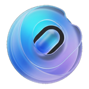
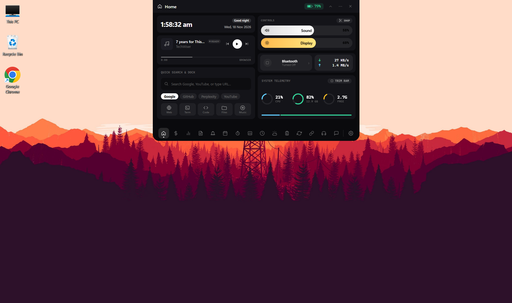
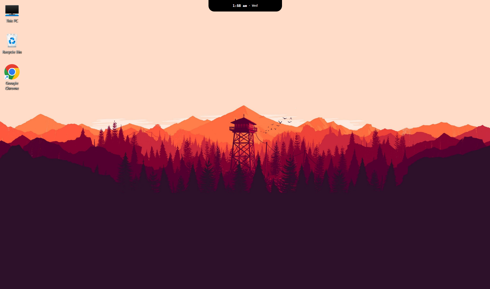
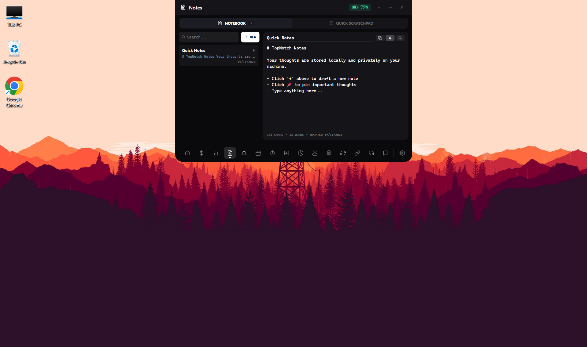
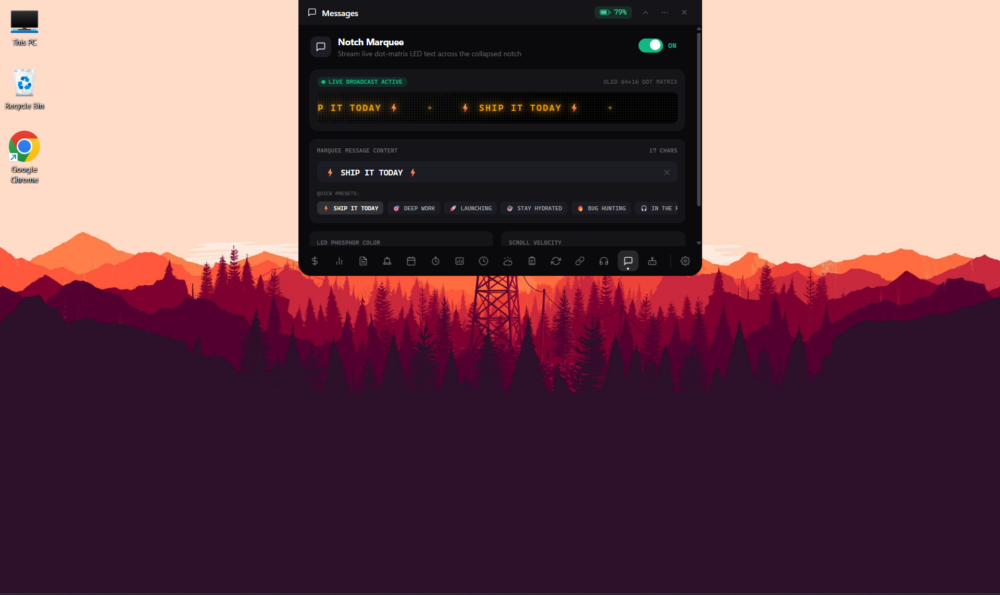
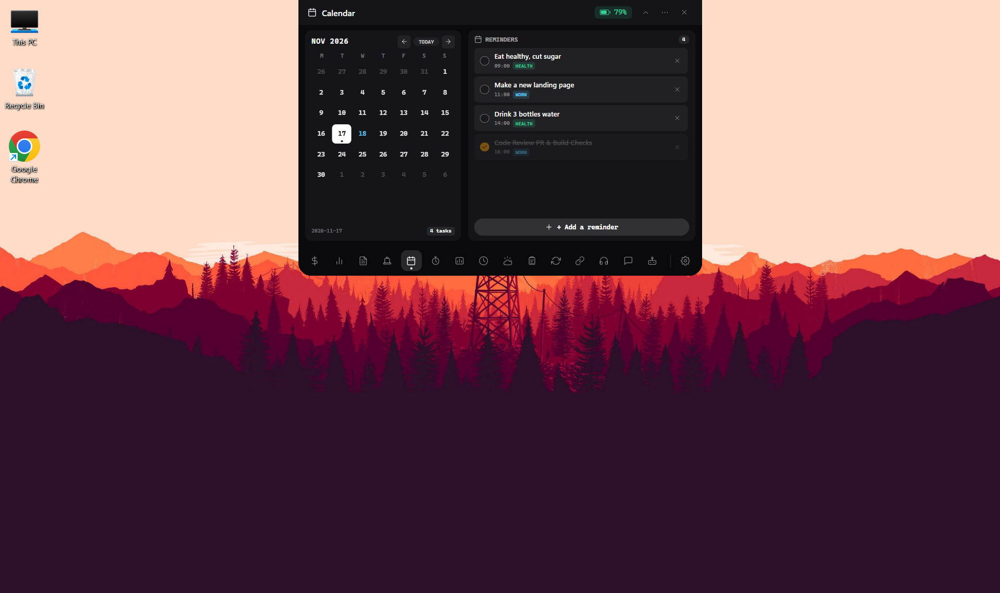

  
  <h1 style="margin-top: 12px; margin-bottom: 4px;">TopNotch</h1>
  
<b>The Floating Dynamic Island & Universal Utility Shelf for Windows</b>

  

    
    
    
    
  

  

    <a href="https://apps.microsoft.com/detail/9NT7MW2M4R45"><b>Get on Microsoft Store</b></a> &nbsp;•&nbsp;
    <a href="https://topnotchapp.vercel.app"><b>Official Website</b></a> &nbsp;•&nbsp;
    <a href="#-downloads"><b>Downloads</b></a> &nbsp;•&nbsp;
    <a href="#-features"><b>Features</b></a> &nbsp;•&nbsp;
    <a href="#-shortcuts"><b>Shortcuts</b></a> &nbsp;•&nbsp;
    <a href="PRIVACY.md"><b>Privacy Policy</b></a>
  

---

## ⚡ What is TopNotch?

**TopNotch** brings the fluid, modern luxury of the **Apple Dynamic Island & macOS Control Center** natively to Windows 11 and Windows 10.

Resting discreetly at the top bezel of your display as an unobtrusive 36px hardware-style pill, TopNotch expands with smooth spring physics whenever you copy text, grab a screenshot, play music, or drag files. With a single click or keyboard shortcut (<kbd>Ctrl</kbd> + <kbd>Space</kbd> or <kbd>Alt</kbd> + <kbd>\</kbd>), it blooms into a productivity dashboard, macOS-style Control Center with live brightness and volume sliders, and a temporary parking shelf with an offline image converter.

---

## 📸 Desktop Previews

  
  
<i><b>Home & macOS-Style Control Center</b>: Display brightness and sound sliders, Bluetooth battery indicators, live network throughput (↓↑), and system vitals.</i>

   
  
  
<i><b>Resting Dynamic Notch</b>: Minimalist 36px pill docked seamlessly to the top bezel.</i>

   
  
  
<i><b>Quick Notes & Markdown Notebook</b>: Always-ready distraction-free notes stored in local SQLite.</i>

   
  
  
<i><b>LED Dot-Matrix Marquee</b>: 64×16 OLED text banners streaming across the collapsed notch.</i>

   
  
  
<i><b>Calendar & Reminders</b>: Monthly deadlines, meeting checklists, and hydration nudges.</i>

---

## 📥 Downloads

Choose your preferred way to install:

| Method | Type | Best For | Link |
| :--- | :--- | :--- | :--- |
| **Microsoft Store** | Official Store App | Automatic background updates & verified security | [**Get from Microsoft Store**](https://apps.microsoft.com/detail/9NT7MW2M4R45) |
| **Windows Package Manager** | `winget` | Command-line quick install | `winget install topnotch` |
| **Direct MSIX Package** | `.msix` Container (v0.2.0.0) | Sideload & Enterprise deployment | [**Download TopNotch.msix (Releases)**](https://github.com/Kaifazad/TopNotch/releases) |
| **Standalone Setup** | `.exe` Installer | Traditional desktop installer | [**Download TopNotch Setup (.exe)**](https://github.com/Kaifazad/TopNotch/releases) |

> **System Requirements**: Windows 11 or Windows 10 (64-bit). No administrator elevation required (`asInvoker`).

---

## 🌟 Key Features

### 🏝️ 1. Ultra-Minimal Dynamic Island Alerts
- Instant, non-intrusive notification pill for all clipboard activity.
- Smart content recognition:
  - 📋 **Code & Text**: Live snippet preview with character count and domain tags.
  - 🖼️ **Images & Screenshots**: Rich thumbnail badges.
  - 📁 **Files & Folders**: Quick item count and filesystem path confirmation chips.
  - 🎵 **Media Playback**: Live equalizer bars and track titles via GSMTC.

### 🎛️ 2. macOS-Style Control Center & Hardware Telemetry
- **Hardware Sliders**: Smooth, non-blocking Display Brightness and Master Volume controls.
- **Bluetooth Quick Manager**: Live earbud/headphone battery indicators (e.g. AirPods, Galaxy Buds).
- **Network Throughput**: Real-time download and upload speed meters powered by Win32 `IPHLPAPI`.
- **System Telemetry**: CPU load, RAM utilization, and one-click RAM Trim.

### 🗄️ 3. Universal Parking Shelf & Offline Converter
- **Drag & Drop Anything**: Drag images, files, or text from web browsers, File Explorer, or your desktop directly onto the notch to park them.
- **Offline Image Converter**: Convert images between WebP, PNG, JPEG, ICO, and PDF with 100% offline local processing.
- **Clipboard Parking (`Ctrl + V`)**: Press <kbd>Ctrl+V</kbd> while the shelf is open to instantly store clipboard items.

### 🎯 4. Tactile Drag-to-Reposition
- Hover over the right edge of the notch to reveal the tactile **6-dot grip handle**.
- Slide TopNotch horizontally along your top screen bezel so it never blocks browser tabs or web cameras.

### ⏱️ 5. Focus Timers & Pomodoro
- **Millisecond Stopwatch**: Instant split lap recording.
- **Pomodoro Focus Arc**: Visual 25/5 focus cycles built directly into the notch.
- **Quick Presets**: 5m, 15m, 30m, and 60m countdown timers for meetings and deep work.
- **Hydration Reminders**: Periodic gentle nudges to keep you hydrated throughout the day.

### 🎵 6. Relaxing Ambient Soundscapes
- Built-in sound engine: Rain, Thunder, Ocean Waves, White Noise, Campfire, Forest Birds, Coffee Shop, Stream, Wind, and Lo-Fi.
- Independent volume sliders and sleep timer.

### 🔒 7. 100% Private, Local-First & Safe
- **Zero Telemetry**: We do not collect, track, or sell your data.
- **No External Servers**: All notes, settings, and parked files remain 100% on your local disk in SQLite.
- **Safe Execution**: Runs as standard user mode (`asInvoker`). Never requests administrative elevation.
- **Optional Windows Startup**: Easily toggle automatic launch on Windows boot from Settings.

---

## ⌨️ Shortcuts

| Shortcut | Action |
| :--- | :--- |
| <kbd>Ctrl</kbd> + <kbd>Space</kbd> | Toggle TopNotch Shelf & Control Center |
| <kbd>Alt</kbd> + <kbd>\</kbd> | Alternative Quick Flyout Toggle |
| <kbd>Alt</kbd> + <kbd>P</kbd> | Quick Pomodoro Focus Timer |
| <kbd>Alt</kbd> + <kbd>B</kbd> | Quick Bookmarks / Battery Info |
| <kbd>Esc</kbd> | Collapse Flyout back into resting notch |

---

## ❓ Frequently Asked Questions (FAQ)

<b>Is TopNotch free to use?</b>

Yes! TopNotch is free to download and use for both personal and commercial productivity.

<b>Does TopNotch track my clipboard or files?</b>

No. TopNotch is strictly offline-first. Clipboard content and parked files are processed exclusively in your computer's local memory and private local storage. Zero data leaves your machine. See our <a href="PRIVACY.md">Privacy Policy</a>.

<b>How do I move the notch to the left or right?</b>

Hover your mouse over the right side of the notch to reveal the 6-dot grip handle. Click and drag it horizontally anywhere along the top edge of your screen.

<b>Can I launch TopNotch automatically when my PC starts?</b>

Yes! Open TopNotch Settings (<kbd>Ctrl</kbd> + <kbd>Space</kbd> &rarr; Gear icon) and enable "Launch on Windows Startup".

---

## 📄 License & Contact

- **Website**: [https://topnotchapp.vercel.app](https://topnotchapp.vercel.app)
- **Microsoft Store**: [https://apps.microsoft.com/detail/9NT7MW2M4R45](https://apps.microsoft.com/detail/9NT7MW2M4R45)
- **Privacy Policy**: Read our [Privacy Policy](PRIVACY.md).
- **Developer**: Kaif Azad ([itzkaifazad@gmail.com](mailto:itzkaifazad@gmail.com)).
